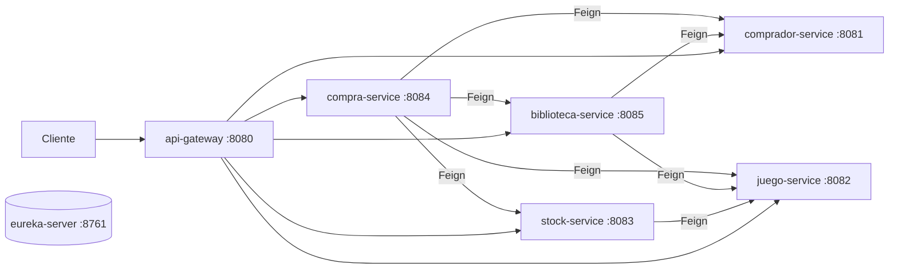

# GameStore Platform

Tienda de videojuegos construida con **microservicios** en **Spring Boot 4**, **Spring Cloud** y **Maven multimódulo**.
Los servicios se registran en **Eureka**, se comunican entre sí con **OpenFeign** y se exponen por un **API Gateway**.

## Integrantes

- Joseph Gonzalez

## Arquitectura



| Módulo | Puerto | Base de datos | Se conecta con (Feign) |
|---|---|---|---|
| `0.eureka-server` | 8761 | - | - |
| `1.comprador-service` | 8081 | `comprador_db` | - |
| `2.juego-service` | 8082 | `juego_db` | - |
| `3.stock-service` | 8083 | `stock_db` | juego |
| `4.compra-service` | 8084 | `compra_db` | comprador, juego, stock, biblioteca |
| `5.biblioteca-service` | 8085 | `biblioteca_db` | comprador, juego |
| `api-gateway` | 8080 | - | todos (vía Eureka) |

### Regla principal

Al comprar un juego, `compra-service` valida al comprador y el juego, **rechaza la compra si el comprador ya lo posee en su biblioteca**, descuenta stock y agrega el juego a la biblioteca. Si algo falla en el camino, devuelve la unidad al stock.

Cada microservicio tiene su propia base de datos MySQL. Los datos de entrada/salida usan **DTOs** y las entidades JPA quedan reservadas para persistencia. Los servicios que consumen otros microservicios usan **Feign** con timeout de conexión y lectura configurado.

## Requisitos

- JDK 21
- Maven 3.9+ (opcional: el proyecto incluye el wrapper `mvnw`, que descarga Maven solo y únicamente necesita el JDK)
- MySQL 8 (por ejemplo XAMPP) en el puerto 3306 con usuario `root` sin contraseña
- Docker Desktop (solo para la versión Docker)

## Cómo ejecutar

### 1. Compilar todo el proyecto

```bash
mvn clean install
```

Si `mvn` no está instalado, usar el wrapper incluido (solo requiere el JDK):

```bat
mvnw.cmd clean install
```

En Linux/Mac: `./mvnw clean install`. Esto compila los 7 módulos y corre las pruebas unitarias. Para omitirlas, agregar `-DskipTests`.

### 2. Ejecución nativa (Windows)

Con MySQL encendido, ejecutar:

```bat
arrancar-nativo.bat
```

El script verifica que exista Java, compila el proyecto la primera vez (usa `mvn` si está instalado o, si no, `mvnw.cmd`) y luego abre una ventana por servicio ejecutando cada `.jar` con `java -jar`.

También se puede levantar cada servicio a mano (en el orden indicado abajo), por ejemplo: `java -jar 1.comprador-service\target\comprador-service-1.0.0.jar`.

Los servicios usan `localhost` por defecto. Se puede cambiar con las variables `DB_HOST`, `DB_PORT`, `DB_USER`, `DB_PASSWORD` y `EUREKA_HOST`.

### 3. Ejecución con Docker

```bash
mvn clean install -DskipTests
docker compose up --build
```

El compose levanta MySQL (puerto 3307 en el host), Eureka, los 5 servicios y el gateway. Dentro de Docker los servicios usan `DB_HOST=mysql` y `EUREKA_HOST=eureka-server`.

## Orden de arranque

1. MySQL
2. `eureka-server`
3. `comprador-service`, `juego-service`, `stock-service`, `biblioteca-service`, `compra-service` (cualquier orden entre ellos)
4. `api-gateway`

## Bases de datos

Las bases se crean automáticamente al iniciar cada servicio. También hay un script completo en `docs/bd-general.sql` con las bases, tablas y restricciones. Las referencias entre microservicios (`compradorId`, `juegoId`) son relaciones lógicas validadas mediante Feign; no se usan foreign keys entre bases independientes.

## URLs útiles

| Qué | URL |
|---|---|
| Eureka | http://localhost:8761 |
| API Gateway | http://localhost:8080 |
| Swagger comprador | http://localhost:8081/swagger-ui/index.html |
| Swagger juego | http://localhost:8082/swagger-ui/index.html |
| Swagger stock | http://localhost:8083/swagger-ui/index.html |
| Swagger compra | http://localhost:8084/swagger-ui/index.html |
| Swagger biblioteca | http://localhost:8085/swagger-ui/index.html |

## API Gateway

Rutas disponibles en `http://localhost:8080`:

| Ruta | Servicio |
|---|---|
| `/api/compradores/**` | comprador-service |
| `/api/juegos/**` | juego-service |
| `/api/stock/**` | stock-service |
| `/api/compras/**` | compra-service |
| `/api/biblioteca/**` | biblioteca-service |

El detalle de cada endpoint y un flujo de prueba están en [`docs/endpoints.md`](docs/endpoints.md).

La colección de Postman lista para importar está en [`docs/postman/GameStore.postman_collection.json`](docs/postman/GameStore.postman_collection.json).
## Pruebas unitarias

```bash
mvn test
```

Cada servicio tiene su `*ServiceImplTest` (JUnit 5 + Mockito); los clientes Feign se simulan con mocks, así que no necesitan MySQL ni Eureka.

## Video de defensa

- Link: (pendiente)
